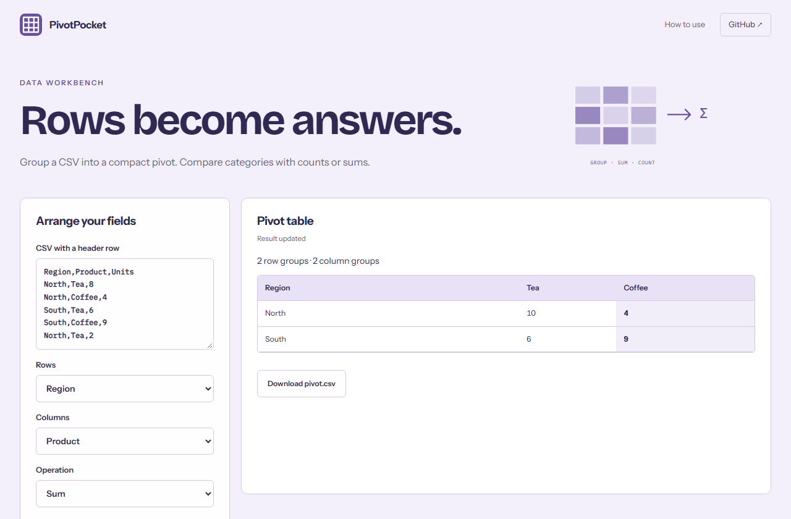

# PivotPocket

**Pivot CSV in your browser.** Group rows by two columns and calculate counts or sums without uploading your data.

[Open the live tool](https://musabukhari237.github.io/pivotpocket/) · [Report an issue](https://github.com/MusaBukhari237/pivotpocket/issues)

[](https://musabukhari237.github.io/pivotpocket/)

## Try an example

Load the example and build a pivot. North has 10 units of Tea. Switch from Sum to Count rows to compare record counts.

## Usage and limits

Count rows or sum decimal values. Decimal sums use JavaScript floating point and suit exploratory analysis. Export escapes formula-like text for spreadsheets.

## Run locally

Clone this repository, then run:

```sh
python -m http.server 8000 --bind 127.0.0.1 --directory docs
```

Open http://127.0.0.1:8000 in a browser. The site needs no package install. Run `node --test` with Node.js 22 or newer.

## Interface

A lavender data workspace puts field selectors in a narrow rail beside a wide pivot table with emphasized totals.

Use Ctrl+Enter or Command+Enter to run the current inputs. Clear editor clears pasted text, and View results moves keyboard focus to the output. Status text identifies changed inputs and refreshed results.

Fonts and imagery are bundled locally. Visual sources and font licenses are recorded in [asset credits](docs/Assets.md).

## Sponsors

Supported by [LeadCeleris](https://www.leadceleris.com/) and [AIFFICIENTO](https://www.aifficiento.biz/).

## Contributing and license

Use synthetic input in bug reports and contributions. See [contribution notes](CONTRIBUTING.md) and the [MIT license](LICENSE).
